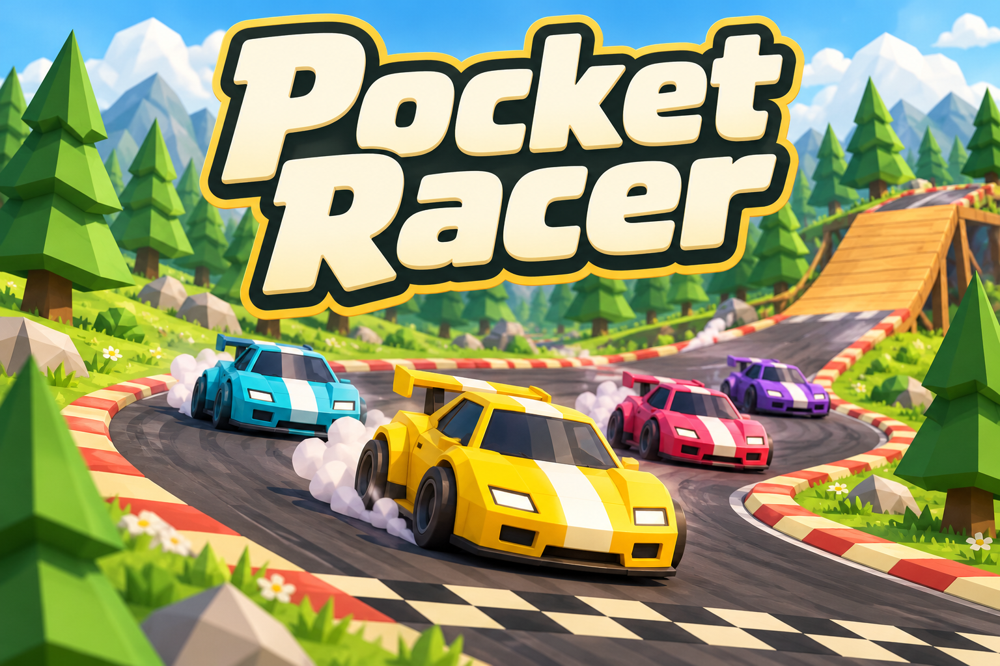

# Pocket Racer branding



Official name: **Pocket Racer**.

## Art direction

Rounded cream motorsport lettering, bright meadow grass, faceted trees and four toy cars on a charcoal circuit with striped curbs and a wooden ramp.

The existing 2D Racer/documentation/screenshot01.png gameplay capture and 2D Racer/src/world.ts establish the toy cars, grass, faceted trees, checkered line and ramp. The screenshot was viewed for visual context only. The final image was generated from a text prompt without supplying, cropping, tracing or compositing a screenshot.

## Asset and usage

- File: `docs/images/game-logo.png`.
- Purpose: README splash illustration and game-directory thumbnail.
- Generation: built-in OpenAI image generation through the existing Codex session. No API key, separately billed API or external image service was used.
- Format: opaque PNG, 1536 by 1024 pixels.
- Keep the complete title visible when displaying or resizing the image. The official name excludes "Multiplayer"; multiplayer capability remains documented separately where applicable.

## Final generation prompt

```text
Use case: logo-brand. Create a completely original landscape 3:2 arcade game splash illustration from scratch. Exact and only title: "Pocket Racer", with those exact words, huge and instantly readable at 240px thumbnail width. Friendly bold rounded ivory motorsport lettering with dark charcoal-green outline and a small golden-yellow offset edge fills the upper half. Below the title, a little yellow toy sports car leads cyan, pink-red and violet toy rivals through a sweeping dark asphalt circuit with red-and-cream curb stripes, a black-and-cream checkered finish stripe and a tan wooden jump ramp, surrounded by bright meadow-green grass and faceted evergreen trees. New elevated three-quarter promotional composition with energetic cornering and tiny puffs of tire smoke; keep the yellow car prominent. Charming polished low-poly 3D cartoon illustration, simple blocky cars, soft sunny lighting, cheerful green/cream/charcoal palette with yellow, cyan, pink and violet accents. Inspired by the actual game's procedural cartoon cars, grassy circuit, triangular trees and ramps. Entirely original composition, no screenshot, game HUD or screen frame, no manufacturer branding, no other lettering, no watermark, never Multiplayer. Generous title safe margins, opaque background.
```
